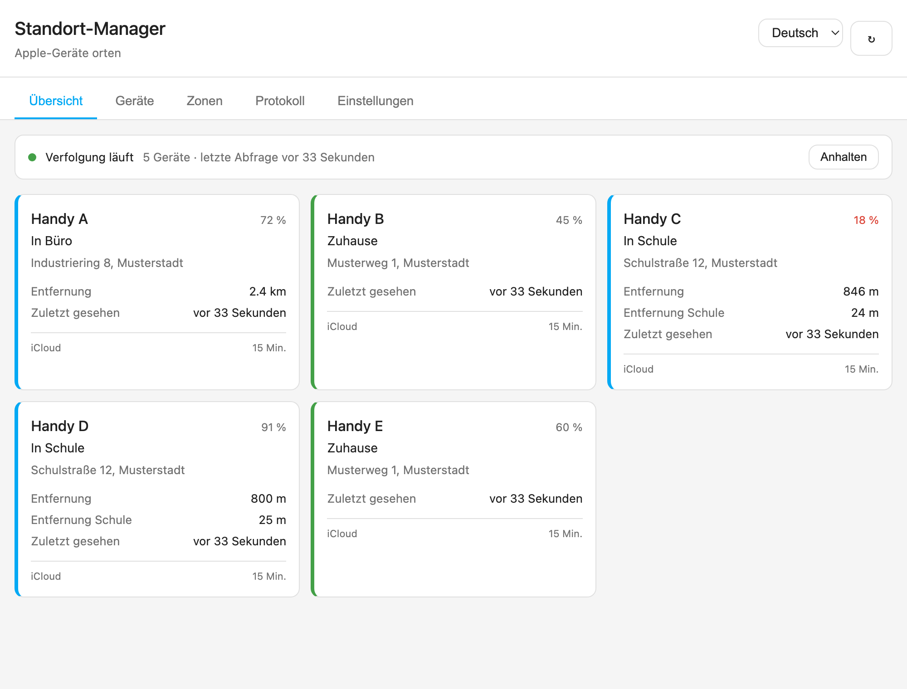

# Standort-Manager

Home-Assistant-Add-on zur Standortverfolgung von Apple-Geräten — mit eigener
Oberfläche und von Grund auf mehrsprachig.

Das Add-on fragt Apples Ortungsdienst ab, ordnet den Standort den Zonen aus
Home Assistant zu und veröffentlicht das Ergebnis per MQTT-Discovery als
`device_tracker` und Sensoren. Dazu kommen Adressauflösung, gelernte
Fahrzeiten, Befehle an die Geräte und eine Dashboard-Karte.



## Was es kann

**Ortung**

* Standort, Zone und Entfernung je Gerät, als `device_tracker` in Home Assistant
* Adresse statt Koordinaten (OpenStreetMap/Nominatim)
* Fahrtdauer und voraussichtliche Ankunft, mit gelernter Korrektur
* Fahrtrichtung relativ zum Ziel — nähert sich oder entfernt sich
* Akkustand, Genauigkeit, Tempo, Himmelsrichtung, zurückgelegte Strecke
* Abfragetakt richtet sich nach dem Zustand: zuhause träge, unterwegs dicht,
  bei Annäherung an eine Zone dichter
* Zwei Quellen je Gerät: iCloud und — wo installiert — der Tracker der
  Home-Assistant-Companion-App, die Zonenwechsel schneller meldet
* Zonen einzeln ein- und ausschaltbar; die Liste zeigt, wer gerade wo ist
* Eine zweite Bezugszone je Gerät neben dem Zuhause, etwa die Schule
* Mehrere Apple-Konten, wenn die Familie auf mehr als eine Apple-ID verteilt ist

**Steuerung**

* Ton abspielen, Nachricht auf den Sperrbildschirm, Verloren-Modus
* Schaltflächen und ein Schalter in Home Assistant, aus Automationen nutzbar
* Dashboard-Karte, die das Add-on selbst mitbringt und anmeldet — mit
  visuellem Editor, ohne YAML

**Sprache**

* Oberfläche, Protokoll und Entitätsnamen umschaltbar
* Deutsch und Englisch vollständig; eine weitere Sprache braucht eine Datei

## Mehrsprachigkeit als Bauweise

Die Sprachfähigkeit ist keine nachträgliche Übersetzungsschicht:

* Im Code steht **kein einziger fertiger Satz**. Überall stehen Schlüssel wie
  `event.device_arrived`, die erst beim Anzeigen übersetzt werden.
* Auch das **Ereignisprotokoll** speichert Schlüssel plus Parameter. Stellt man
  die Sprache um, wechselt das bereits aufgezeichnete Protokoll mit — und eine
  später ergänzte Sprache erfasst rückwirkend alles.
* **Entitäts-IDs bleiben sprachneutral**, nur die Anzeigenamen werden übersetzt.
  Ein Sprachwechsel ändert also keine Entitäts-ID und bricht keine Automation.
* Backend und Oberfläche teilen sich denselben Katalog und dieselbe
  Rückfallkette: gewählte Sprache → Englisch → der Schlüssel selbst.

Siehe [TRANSLATING.md](TRANSLATING.md), um eine Sprache hinzuzufügen.

## Installation

1. Dieses Repository in Home Assistant als Add-on-Repository hinzufügen:
   Einstellungen → Add-ons → Add-on-Store → ⋮ → Repositories →
   `https://github.com/Melle79/standort-manager`
2. „Standort-Manager" installieren und starten.
3. Oberfläche öffnen und mit der Apple-ID anmelden, in deren Familienfreigabe
   die Geräte liegen. Apple schickt einen sechsstelligen Bestätigungscode.
4. Unter **Geräte** die Betriebsart je Gerät festlegen.

Apple-ID und Passwort werden **nur** in der Oberfläche eingegeben, nie in der
Add-on-Konfiguration. Sie liegen verschlüsselt unter `/data`; die Sitzung
überlebt Neustarts, sodass der Code nur alle paar Wochen nötig ist.

Die vollständige Bedienungsanleitung steht in
[standort_manager/DOCS.md](standort_manager/DOCS.md) und im Add-on selbst
unter „Dokumentation".

## Voraussetzungen

* Home Assistant OS oder Supervised (das Add-on braucht den Supervisor)
* Ein MQTT-Broker, etwa das Mosquitto-Add-on — ohne ihn läuft die Oberfläche,
  es entstehen aber keine Entitäten
* Eine Apple-ID mit Zwei-Faktor-Authentifizierung und „Wo ist?" auf den Geräten

## Entwicklung

```bash
python3 tools/check_translations.py   # Kataloge gegen den Code prüfen
python3 tests/test_2fa.py             # Anmeldung mit Code übersteht Neustart
python3 tests/test_konten.py          # Umstellung auf mehrere Apple-Konten
python3 tests/test_logik.py           # Zonen, Zustände, Abfragetakte
python3 tests/test_mqtt.py            # Discovery, Entitäts-IDs, Sprachwechsel
```

Die Tests laufen ohne Netz, ohne Apple-Konto und ohne Home Assistant — alle
äußeren Dienste sind durch Attrappen ersetzt. Die Module des Add-ons werden
dabei aber wirklich importiert, deshalb braucht es deren Abhängigkeiten:

```bash
pip install cryptography flask paho-mqtt requests pyicloud rich
```

`check_translations.py` meldet Schlüssel, die im Code benutzt, aber nicht
übersetzt sind, Lücken zwischen den Sprachen und Platzhalter, die sich
zwischen Sprachen unterscheiden. Vor jedem Release ausführen.

### Aufbau

```
standort_manager/
├── app/
│   ├── server.py          Flask: Oberfläche und API
│   ├── apple.py           Apple-Konten, Anmeldung, Gerätebefehle
│   ├── tracking.py        Zonen, Zustände, Abfragetakte
│   ├── mqtt_publisher.py  Discovery und Veröffentlichung
│   ├── fahrten.py         gelernte Fahrzeiten (SQLite)
│   ├── geocode.py         Adressauflösung
│   ├── route.py           Routenberechnung
│   ├── ha.py              Zonen und Companion-Tracker aus Home Assistant
│   ├── lovelace.py        Dashboard-Karte ausliefern und anmelden
│   ├── store.py           Einstellungen und verschlüsselte Zugangsdaten
│   ├── events.py          Ereignisprotokoll (Schlüssel statt Sätze)
│   └── i18n.py            Übersetzungskern
├── translations/          de.json, en.json
└── www/                   Oberfläche und Dashboard-Karte
```

## Lizenz

MIT — siehe [LICENSE](LICENSE).

Das Projekt ist eigenständig. Für den Zugriff auf Apples Ortungsdienst benutzt
es [pyicloud](https://github.com/timlaing/pyicloud). Die Adressauflösung nutzt
[Nominatim](https://nominatim.openstreetmap.org/), die Routenberechnung
[OSRM](https://project-osrm.org/) — beide nur im Rahmen ihrer
Nutzungsbedingungen für den privaten Gebrauch.
