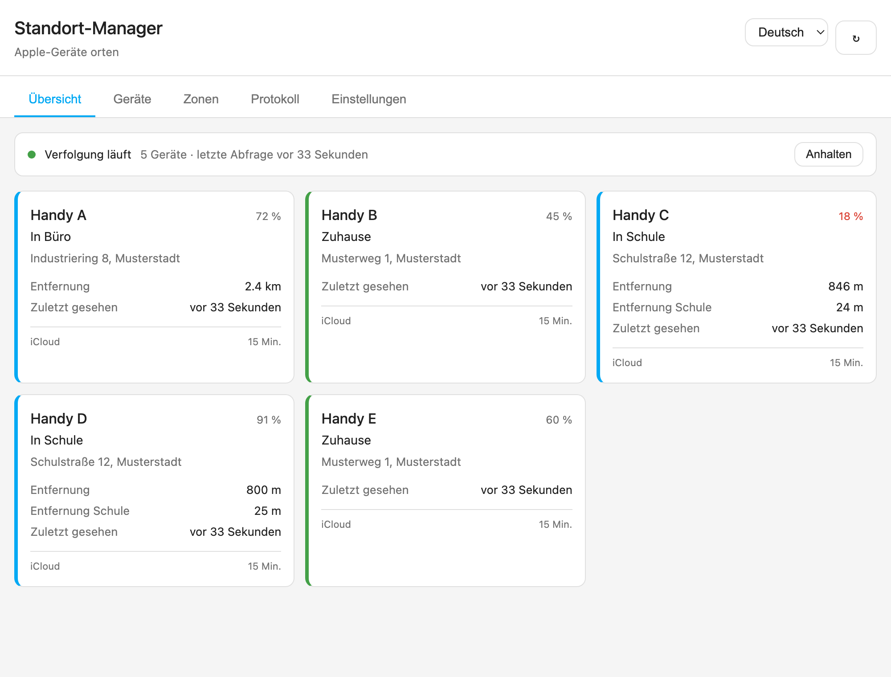
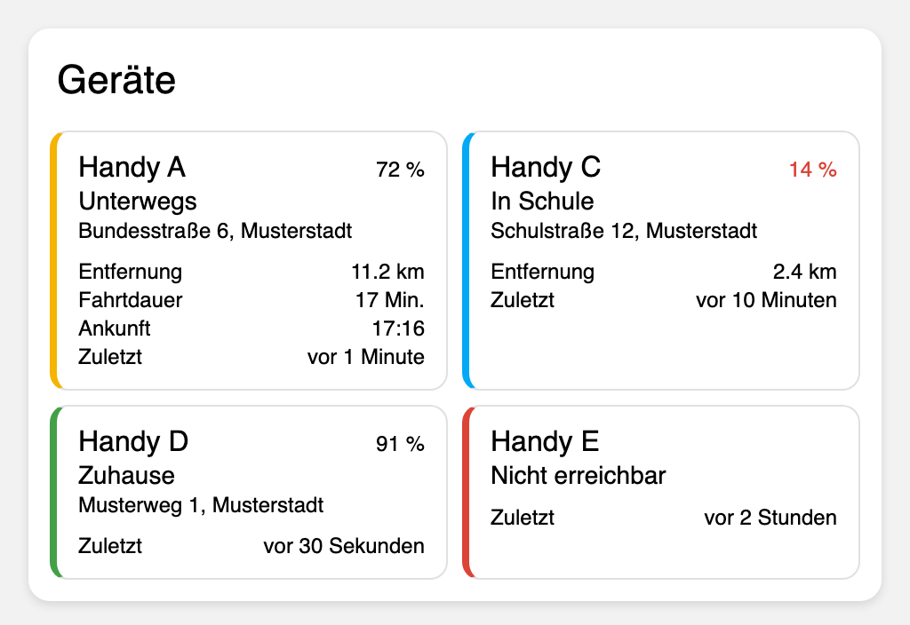

# Standort-Manager

Verfolgt Apple-Geräte über Apples Ortungsdienst und veröffentlicht sie als
Entitäten in Home Assistant.



## Einrichtung

### 1. Anmelden

Öffne die Oberfläche des Add-ons und melde dich mit der Apple-ID an, in deren
Familienfreigabe die Geräte liegen. Apple schickt einen sechsstelligen Code an
deine Apple-Geräte.

Setze **Dieser Anmeldung vertrauen** — dann fragt Apple etwa zwei Monate lang
nicht erneut nach einem Code.

Apple-ID und Passwort werden nur hier eingegeben, nie in der
Add-on-Konfiguration. Sie liegen verschlüsselt unter `/data`, und die Sitzung
übersteht Neustarts des Add-ons.

Lass **Passwort speichern** gesetzt. Ohne gespeichertes Passwort kann sich das
Add-on nach Ablauf der Sitzung nicht selbst wieder anmelden, und du musst den
Code von Hand nachreichen.

### 2. Geräte einrichten

Unter **Geräte** legst du je Gerät die Betriebsart fest:

| Betriebsart | Bedeutung |
|---|---|
| Verfolgen | Wird regelmäßig abgefragt und erzeugt Entitäten in Home Assistant |
| Nur beobachten | Wird mitgelesen, wenn ohnehin abgefragt wird — kein eigener Takt |
| Inaktiv | Wird vollständig übersprungen |

Die Liste ist zusammengeklappt; ein Klick auf ein Gerät öffnet seine
Einstellungen. Der Punkt vor dem Namen zeigt die Betriebsart, ohne dass du
aufklappen musst: grün für Verfolgen, gelb für Nur beobachten, ein leerer
Ring für Inaktiv.

Stell alles auf **Inaktiv**, was du nicht brauchst. Ein Apple-Konto bringt
schnell zwei Dutzend Geräte mit, darunter AirPods, Uhren und Rechner. Jedes
verfolgte Gerät kostet Akku und reizt Apples Sperren.

Achte auf die Namen: Apple listet auch längst ausgemusterte Geräte. Ein
„iPhone von …“, das ein zehn Jahre altes Modell ist, gehört auf **Inaktiv**.

### 3. Companion-App verknüpfen (optional)

Läuft auf einem Gerät die Home-Assistant-App, kannst du deren
`device_tracker`-Entität zuordnen. Sie meldet Zonenwechsel in Sekunden statt
Minuten und wird bevorzugt, sobald ihre Messung frischer ist als die von iCloud.

Wähle dort **nicht** den Tracker einer anderen Ortungsintegration — sonst
reicht das Add-on fremde Daten als eigene weiter.

## Entitäten

Je verfolgtem Gerät entstehen ein `device_tracker` und sechzehn Sensoren.

`device_tracker.standort_<gerät>` — Zone oder `not_home`, mit Koordinaten,
Genauigkeit und Akkustand als Attribute.

| Sensor | Inhalt |
|---|---|
| `_distance` | Entfernung zur Heimzone |
| `_travel_time` | Fahrtdauer nach Hause |
| `_arrival_time` | Voraussichtliche Ankunft |
| `_direction_home` | Fahrtrichtung: nähert sich oder entfernt sich |
| `_battery` | Akkustand |
| `_battery_state` | Lädt / lädt nicht / voll |
| `_address` | Lesbare Adresse |
| `_zone` | Name der aktuellen Zone |
| `_zone_distance` | Entfernung zur nächstgelegenen Zone |
| `_last_seen` | Zeitpunkt der letzten Ortung |
| `_next_update` | Zeitpunkt der nächsten Abfrage |
| `_accuracy` | Genauigkeit in Metern |
| `_speed` | Geschwindigkeit |
| `_direction` | Himmelsrichtung |
| `_moved_distance` | Strecke seit der letzten Messung |
| `_interval` | Aktueller Abfragetakt |
| `_local_time` | Ortszeit — nur bei gesetztem Zeitversatz |

Ist eine **zweite Bezugszone** gewählt, kommen `_ref_distance`,
`_ref_travel_time` und `_ref_arrival_time` dazu.

### Automationen richtig anbinden

Das Attribut `state_key` des Trackers trägt den Zustand sprachneutral:
`home`, `away`, `traveling`, `in_zone`, `stationary` oder `offline`.
**Prüfe Automationen immer gegen `state_key`**, nicht gegen den Anzeigetext —
der wechselt mit der Sprache. `state_text` daneben enthält denselben Zustand
übersetzt, für Karten und Ansagen.

Dasselbe gilt für die Fahrtrichtung: `heading_key` ist `towards`, `away`,
`stationary` oder `unknown`; der Sensor `_direction_home` zeigt den
übersetzten Satz.

## Steuerung

Ein Add-on kann keine Home-Assistant-Dienste anbieten — das können nur
Integrationen. Den gleichen Zweck erfüllen Schaltflächen, die in Automationen
genauso ansteuerbar sind.

Je verfolgtem Gerät:

| Entität | Wirkung |
|---|---|
| `button.standort_<gerät>_locate` | Sofort orten, ohne auf den Takt zu warten |
| `button.standort_<gerät>_sound` | Ton abspielen, auch im Lautlos-Modus |
| `button.standort_<gerät>_message_send` | Nachricht auf dem Sperrbildschirm |
| `text.standort_<gerät>_message` | Der Text, den die Schaltfläche verschickt |

Global:

| Entität | Wirkung |
|---|---|
| `switch.standort_tracking` | Verfolgung anhalten und fortsetzen |
| `button.standort_locate_all` | Alle Geräte sofort orten |

Beispiel — Nachricht ans Kind schicken, wenn es zur Abendbrotzeit nicht da ist:

```yaml
action:
  - action: text.set_value
    target:
      entity_id: text.standort_handy_c_message
    data:
      value: "Abendessen ist fertig!"
  - action: button.press
    target:
      entity_id: button.standort_handy_c_message_send
```

Nicht jedes Gerät nimmt jeden Befehl an: Ein Mac spielt keinen Ton ab, AirPods
zeigen keine Nachricht. Das Add-on meldet das im Protokoll, statt es zu
verschlucken.

**Verloren-Modus** gibt es bewusst nur in der Oberfläche des Add-ons, mit
Rückfrage und Eingabe der Rückrufnummer — nicht als Schaltfläche. Er sperrt
das iPhone, und ein Fehlgriff in einem Dashboard hätte unangenehme Folgen.

## Dashboard-Karte



Das Add-on legt die Karte beim Start unter `/config/www` ab und meldet sie
selbst als Lovelace-Ressource an. Danach steht `standort-manager-card` in der
Kartenauswahl:

```yaml
type: custom:standort-manager-card
title: Geräte
columns: 2
show_address: true
```

Einstellen lässt sich das auch ohne YAML: Die Karte bringt einen visuellen
Editor mit. Im Dashboard auf **Karte bearbeiten** — dort stehen Überschrift,
Spaltenzahl, Adressanzeige und die Geräteauswahl.

Ohne `entities` zeigt sie alle verfolgten Geräte und wächst mit. Mit
`entities` wählst du einzelne aus:

```yaml
type: custom:standort-manager-card
entities:
  - device_tracker.standort_handy_a
  - device_tracker.standort_handy_c
```

Ein Klick auf eine Kachel öffnet den gewohnten Detaildialog. Die Karte folgt
der Sprache von Home Assistant, nicht der des Add-ons.

Klappt die automatische Anmeldung nicht, steht ein Hinweis im Add-on-Protokoll.
Von Hand geht es über Einstellungen → Dashboards → Ressourcen mit
`/local/standort-manager-card.js` als JavaScript-Modul.

## Mehrere Apple-Konten

Unter **Einstellungen → Apple-Konten** lassen sich weitere Apple-IDs
hinzufügen — sinnvoll, wenn die Familie auf mehr als eine verteilt ist. Jedes
Konto bekommt eine eigene Sitzung, und ein Befehl an ein Gerät findet sein
Konto von selbst.

Beim Entfernen eines Kontos verschwinden auch dessen Geräte samt Entitäten.

## Gelernte Fahrzeiten

Routendienste rechnen mit freier Straße. Deshalb vergleicht das Add-on bei
jeder Fahrt die geschätzte mit der tatsächlichen Dauer und korrigiert künftige
Schätzungen — getrennt nach Gerät, Ziel und Tageszeit (morgens, abends, sonst,
Wochenende).

Ab der dritten Fahrt je Kombination wird korrigiert, gerechnet wird mit dem
Median der letzten zwanzig. Der Median statt des Mittelwerts, weil eine
einzelne Vollsperrung sonst wochenlang nachwirkt. Nach ein paar Wochen sind
die Schätzungen damit genauer, als ein Dienst ohne Verkehrsdaten sie liefern
kann.

Was gelernt wurde, steht unter **Einstellungen → Gelernte Fahrzeiten**.

## Zweite Bezugszone

Neben der Heimzone lässt sich je Gerät eine weitere Zone wählen, zu der
Entfernung, Fahrtdauer und Ankunft berechnet werden — etwa die Schule des
jeweiligen Kindes. Die Einstellung steht unter **Geräte**.

## Zeitversatz

Ist ein Gerät dauerhaft in einer anderen Zeitzone, trag unter **Geräte** den
Versatz in Stunden ein. Es entsteht dann ein Sensor mit der Ortszeit des
Geräts. Alle übrigen Zeitangaben bleiben in der Zeit von Home Assistant.

## Abfragetakt

Der Takt richtet sich nach dem Zustand. Die Werte unter **Einstellungen** sind
Obergrenzen; unterwegs rechnet das Add-on aus Entfernung und Tempo einen
dichteren Takt aus.

Kurze Takte kosten Akku und führen dazu, dass Apple die Abfragen bremst. Wird
eine Sperre erkannt, pausiert das Add-on zehn Minuten und meldet das im
Protokoll.

## Protokoll

Unter **Protokoll** steht, was das Add-on zuletzt getan hat — Ankünfte,
Abfahrten, Abfragen, Fehler. Die Stufe **Technisch** zeigt zusätzlich, was
sonst nur intern passiert: Taktwechsel, Quellenwechsel, Routenberechnungen.

Die Einträge werden als Schlüssel gespeichert, nicht als fertige Sätze. Stellst
du die Sprache um, wechselt auch das bereits aufgezeichnete Protokoll mit.

## Sprache

Unter **Einstellungen → Sprache** stellst du Oberfläche, Protokoll und die
Anzeigenamen der Entitäten um. Die Entitäts-IDs ändern sich dabei **nicht** —
Automationen laufen weiter.

Eine neue Sprache braucht nur eine weitere Datei im Ordner `translations`.
Unvollständige Sprachen erscheinen in der Auswahl mit ihrem Deckungsgrad; was
fehlt, kommt auf Englisch.

## Konfiguration des Add-ons

| Option | Bedeutung |
|---|---|
| `mqtt_enabled` | Entitäten per MQTT veröffentlichen |
| `mqtt_host` … `mqtt_password` | Nur nötig für einen Broker außerhalb von Home Assistant; sonst leer lassen |
| `entity_praefix` | Präfix der Entitäts-IDs. Ändern erzeugt neue Entitäten — die alten bleiben als Karteileichen zurück |
| `log_level` | Ausführlichkeit im Add-on-Protokoll |

Sprache, Einheiten, Zeitformat und Abfragetakte stehen bewusst **nicht** hier,
sondern nur in der Oberfläche — zwei Orte für dieselbe Einstellung
widersprechen sich irgendwann.

## Wenn etwas nicht geht

**„Nicht angemeldet" nach einem Neustart** — die Apple-Sitzung ist abgelaufen.
In der Oberfläche neu anmelden; mit gespeichertem Passwort genügt der Code.

**Keine Entitäten in Home Assistant** — unter Einstellungen prüfen, ob der
MQTT-Broker verbunden ist. Ohne Broker läuft die Oberfläche weiter, es
entstehen aber keine Entitäten.

**Ein Gerät bleibt „Nicht erreichbar"** — Apple liefert für dieses Gerät keinen
Standort. Meist ist es ausgeschaltet, ohne Netz, oder „Wo ist?" ist darauf
deaktiviert.

**Standort springt** — die Genauigkeitsschwelle unter Einstellungen senken.
Messungen mit größerer Ungenauigkeit werden dann verworfen.

**Ankunft wird spät gemeldet** — ist die Heimzone klein und der Abfragetakt
groß, vergeht zwischen Ankunft und Meldung eine ganze Abfrage. Die
Companion-App als zweite Quelle behebt das; sie meldet Zonenwechsel sofort.

**Apple bremst** — im Protokoll steht dann, dass Abfragen übersprungen werden.
Weniger Geräte verfolgen und die Takte erhöhen.

## Datenschutz

Alle Standortdaten bleiben zwischen Apple, diesem Add-on und deinem Home
Assistant. Es gibt keine Telemetrie und keinen Dienst des Autors dazwischen.

Zwei externe Dienste werden nur angefragt, wenn du sie eingeschaltet lässt:
**Nominatim** für die Adressauflösung und **OSRM** für die Routenberechnung.
Beide bekommen Koordinaten, aber keine Gerätenamen und keine Kennung. Beide
lassen sich unter Einstellungen abschalten.
